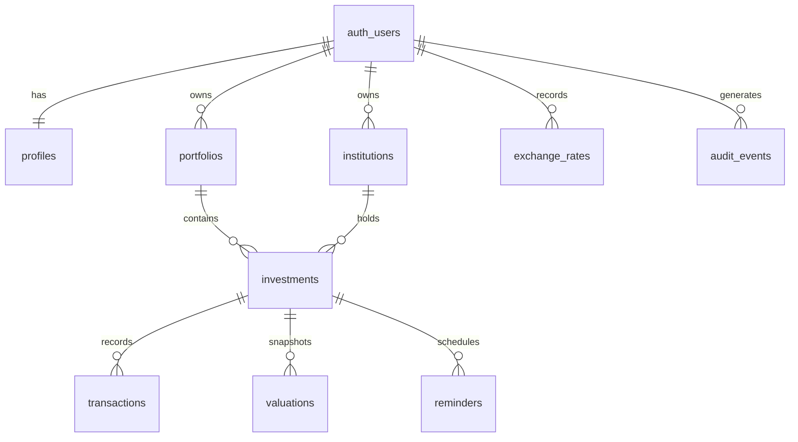

# Plano completo do MVP — InvestNote

> Nome provisório: **InvestNote**. O nome deve ser validado antes do lançamento.
>
> Documento de produto e implementação para orientar a construção do web app pelo Claude.

## 1. Visão do produto

O InvestNote é um web app privado no qual uma pessoa regista, organiza e acompanha investimentos de tipos diferentes num único lugar: depósitos a prazo, criptomoedas, ações, ETFs, fundos, obrigações, P2P/crowdfunding, imobiliário e investimentos personalizados.

O produto combina a liberdade de um bloco de notas com dados estruturados, cálculos transparentes, histórico, prazos e lembretes. O MVP é **manual-first**: o utilizador controla os dados e os valores; não há ligação automática a bancos, corretoras, carteiras ou bolsas nesta fase.

### Proposta de valor

“Veja quanto investiu, onde está o dinheiro, quanto vale, o que rendeu e quais os próximos prazos — mesmo quando os investimentos estão espalhados por várias instituições e classes de ativos.”

### Problema

Quem diversifica os investimentos costuma distribuir informação por aplicações, folhas de cálculo, e-mails e notas. Isso dificulta responder a perguntas simples:

- Quanto capital apliquei no total?
- Onde está concentrado?
- Qual é o valor atual conhecido?
- Que depósitos vencem em breve?
- Quanto recebi em juros, dividendos ou vendas?
- Que informação ainda está desatualizada?

### Objetivo do MVP

Permitir que um utilizador crie a sua carteira, registe investimentos e movimentos, atualize avaliações e acompanhe o conjunto num dashboard claro, seguro e responsivo.

### Métrica principal

**Carteiras ativas semanalmente:** utilizadores que, numa semana, consultaram o dashboard e criaram ou atualizaram pelo menos um investimento, movimento, avaliação ou lembrete.

### Indicadores iniciais

- Tempo até ao primeiro investimento registado: alvo inferior a 3 minutos.
- Taxa de conclusão do onboarding: alvo superior a 70%.
- Utilizadores com 3 ou mais investimentos após 7 dias.
- Percentagem de investimentos com avaliação atualizada nos últimos 30 dias.
- Retenção nas semanas 1 e 4.

## 2. Princípios do produto

1. **Privado por padrão:** cada utilizador só pode aceder aos próprios dados.
2. **Entrada progressiva:** começar com poucos campos obrigatórios e revelar detalhes conforme o tipo de investimento.
3. **Precisão explícita:** distinguir valor registado, valor calculado e estimativa.
4. **Sem aconselhamento financeiro:** organizar e calcular dados fornecidos; não recomendar compra ou venda.
5. **Multiativo sem confusão:** uma estrutura comum, com campos específicos por categoria.
6. **Histórico, não sobrescrita:** compras, reforços, juros, vendas e avaliações ficam registados como eventos.
7. **Moedas honestas:** nunca somar moedas diferentes sem taxa de câmbio definida.
8. **Mobile-first e acessível:** tarefas essenciais devem funcionar bem num telemóvel.

## 3. Público e casos de uso

### Persona principal

Investidor individual que utiliza duas ou mais instituições ou classes de ativos e hoje acompanha parte da carteira por memória, notas ou folhas de cálculo.

### Casos de uso prioritários

1. Registar um depósito a prazo com capital, taxa, início e vencimento.
2. Registar compras e vendas de uma criptomoeda e atualizar o preço conhecido.
3. Registar ações, ETFs ou fundos com quantidade, preço e rendimentos.
4. Registar um investimento não padronizado com campos personalizados e notas.
5. Consultar capital líquido investido, valor atual conhecido, resultado e distribuição.
6. Ver próximos vencimentos e criar lembretes.
7. Consultar o histórico completo de um investimento.

## 4. Escopo do MVP

### P0 — obrigatório para lançamento

- Conta por e-mail e palavra-passe, confirmação de e-mail, login, logout e recuperação de palavra-passe.
- Onboarding curto: nome, moeda base, fuso horário e criação da primeira carteira.
- Uma ou mais carteiras por utilizador.
- Instituições/contas: banco, corretora, exchange, wallet ou entidade personalizada.
- Tipos de investimento:
  - depósito a prazo;
  - criptomoeda;
  - ação, ETF ou fundo;
  - obrigação;
  - P2P, crowdfunding ou imobiliário;
  - outro/personalizado.
- Criação, edição, arquivo e consulta de investimentos.
- Registo de movimentos: investimento inicial, compra/reforço, venda/resgate, juros, dividendo/rendimento, comissão, imposto, levantamento e ajuste.
- Avaliações manuais com data, quantidade opcional, preço unitário opcional e valor total.
- Notas em texto simples/Markdown limitado.
- Data de início, data de vencimento opcional, estado e etiquetas.
- Lembretes dentro da aplicação para vencimentos ou datas personalizadas.
- Dashboard com totais, distribuição, próximos prazos, atualização dos dados e atividade recente.
- Pesquisa, filtros e ordenação na lista de investimentos.
- Exportação dos dados do utilizador para CSV e JSON.
- Interface responsiva, estados vazios, loading, erro e confirmação para ações destrutivas.
- Registo de auditoria básico de alterações relevantes.

### P1 — depois de validar o MVP

- Notificações por e-mail.
- Importação por CSV com pré-visualização e validação.
- Anexos/recibos.
- Cotações automáticas e câmbio por fornecedor externo.
- Autenticação social e 2FA.
- Objetivos de alocação e comparação com alocação atual.
- Partilha somente leitura com contabilista ou parceiro.
- PWA e modo offline limitado.
- Relatórios fiscais por jurisdição, apenas após validação jurídica/contabilística.

### Fora de escopo no MVP

- Acesso a contas bancárias, corretoras ou wallets.
- Execução de ordens, custódia, pagamentos ou transferências.
- Recomendações, scoring, previsão de mercado ou aconselhamento financeiro.
- Cálculo fiscal oficial.
- Dados de mercado em tempo real.
- Comunidade, feed social ou carteira pública.
- Aplicações móveis nativas.

## 5. Conceitos e regras do domínio

### Carteira

Agrupador de investimentos. Exemplo: “Carteira pessoal” ou “Reforma”. Possui uma moeda base, mas pode conter ativos noutras moedas.

### Instituição/conta

Local onde o investimento está registado ou guardado. Exemplos: Banco A, Corretora B, Exchange C, Wallet física. Não guarda credenciais externas.

### Investimento

Entidade duradoura que representa uma posição ou contrato. Guarda identidade, categoria, moeda, estado, prazos e detalhes próprios do tipo.

### Movimento

Evento financeiro imutável na história de um investimento. Uma correção deve editar com auditoria ou criar um ajuste; apagar é permitido apenas com confirmação e auditoria.

Tipos e efeitos sugeridos:

| Movimento | Efeito no capital líquido investido | Efeito em caixa/rendimento | Efeito na quantidade |
|---|---:|---:|---:|
| investimento inicial/compra/reforço | aumenta | saída | aumenta quando aplicável |
| venda/resgate/levantamento de capital | diminui | entrada | diminui quando aplicável |
| juros/dividendo/rendimento | não altera | entrada | não altera, salvo reinvestimento explícito |
| comissão/imposto | aumenta o custo ou reduz resultado | saída | não altera |
| ajuste | definido pelo utilizador | depende | opcional |

Convenção dos montantes: `amount` representa o valor principal do movimento, sempre positivo; o tipo do movimento determina a direção. `fee_amount` e `tax_amount` representam custos acessórios desse mesmo movimento. Quando uma comissão ou imposto for registado como movimento autónomo, o custo fica em `amount` e os campos acessórios permanecem a zero, evitando dupla contagem.

### Avaliação

Fotografia datada do valor de um investimento. A avaliação mais recente alimenta o dashboard. O sistema deve mostrar a data e marcar como desatualizada quando ultrapassar o limite configurado, inicialmente 30 dias.

### Lembrete

Aviso interno associado a um investimento ou carteira. Estados: pendente, concluído, adiado e cancelado.

## 6. Campos por tipo de investimento

### Campos comuns obrigatórios

- Nome.
- Tipo.
- Carteira.
- Moeda ISO 4217, com EUR como sugestão inicial.
- Data de início.
- Instituição/conta opcional.
- Valor inicial ou primeiro movimento.

### Campos comuns opcionais

- Símbolo/ticker.
- Estado: ativo, vencido, encerrado ou arquivado.
- Data de vencimento.
- Etiquetas.
- Notas.
- Campos personalizados do tipo chave/valor.

### Depósito a prazo

- Capital inicial.
- Taxa anual nominal em percentagem.
- Tipo de taxa: fixa ou variável.
- Método: juros simples ou capitalização.
- Frequência de capitalização/pagamento.
- Convenção de dias: ACT/365, ACT/360 ou valor personalizado.
- Data de vencimento.
- Renovação automática: sim/não.
- Retenção/imposto estimado opcional.

O sistema pode apresentar juros estimados, sempre identificados como **estimativa** e acompanhados da fórmula e dos parâmetros. O valor confirmado deve vir de um movimento ou avaliação manual.

### Criptomoeda

- Nome do ativo e símbolo.
- Quantidade, derivada dos movimentos quando possível.
- Exchange/wallet.
- Rede opcional.
- Preço unitário e valor atual na avaliação.

### Ação, ETF ou fundo

- Nome, ticker/ISIN opcional e subtipo.
- Quantidade.
- Bolsa/mercado opcional.
- Preço unitário e valor atual.
- Dividendos como movimentos separados.

### Obrigação

- Emitente.
- Valor nominal e quantidade.
- Taxa de cupão opcional.
- Frequência de cupão.
- Data de vencimento.
- Preço/valor atual manual.

### P2P, crowdfunding ou imobiliário

- Plataforma/projeto.
- Capital aplicado.
- Taxa esperada opcional.
- Data esperada de saída.
- Rendimentos e reembolsos por movimentos.

### Outro/personalizado

- Valor aplicado.
- Valor atual.
- Data de vencimento opcional.
- Campos personalizados e notas.

## 7. Cálculos e definições

Todos os cálculos devem ser executados no servidor ou em funções de domínio partilhadas e cobertos por testes. Usar aritmética decimal; nunca `float` para valores monetários persistidos.

### Métricas por investimento

- **Entradas de capital:** soma de investimento inicial, compras e reforços.
- **Capital devolvido:** componente de capital de vendas, resgates e levantamentos.
- **Capital líquido investido:** entradas de capital − capital devolvido.
- **Rendimentos recebidos:** juros + dividendos + outros rendimentos.
- **Custos:** comissões + impostos registados.
- **Valor atual:** avaliação manual mais recente.
- **Resultado total indicativo:** valor atual + capital devolvido + rendimentos recebidos − entradas de capital − custos.
- **Retorno simples:** resultado total indicativo ÷ entradas de capital, quando entradas > 0.

Não implementar TWR/XIRR no P0; exigem fluxos e convenções mais rigorosos. Podem entrar no P1 com testes específicos.

### Custo médio para ativos com quantidade

Aplicar média ponderada às compras. Vendas reduzem quantidade, mas não reescrevem o custo unitário médio remanescente. Comissões de compra podem ser incluídas no custo quando o utilizador assim indicar. Exibir claramente a metodologia.

### Moedas

- Cada movimento e avaliação guarda a sua moeda.
- A carteira tem uma moeda base.
- O total consolidado só inclui valores que já estejam na moeda base ou tenham uma taxa de câmbio manual datada.
- Valores sem conversão aparecem numa secção “Por converter”; nunca são silenciosamente ignorados.
- Guardar a taxa utilizada no cálculo para que o resultado seja reprodutível.

### Arredondamento

- Persistir valores com precisão alargada, por exemplo `numeric(24,8)`.
- Arredondar apenas na apresentação segundo a moeda/ativo.
- Cripto pode mostrar até 8 casas; valores monetários usam a precisão apropriada da moeda.

## 8. Jornadas principais

### A. Primeiro acesso

1. Criar conta e confirmar e-mail.
2. Informar nome, moeda base e fuso horário.
3. Criar automaticamente “A minha carteira”.
4. Mostrar escolha de tipo de primeiro investimento.
5. Formulário em duas etapas: dados essenciais e detalhes opcionais.
6. Ao guardar, mostrar a ficha e oferecer “Adicionar movimento”, “Criar lembrete” ou “Voltar ao dashboard”.

### B. Registar depósito a prazo

1. Escolher depósito a prazo.
2. Informar banco, capital, moeda, taxa, início e vencimento.
3. Mostrar resumo e estimativa transparente.
4. Criar automaticamente um movimento inicial e sugerir lembrete antes do vencimento.
5. Confirmar e abrir a ficha do investimento.

### C. Registar cripto

1. Escolher criptomoeda.
2. Informar ativo, exchange/wallet e moeda de cotação.
3. Adicionar compra: data, quantidade, preço e comissão.
4. Mostrar quantidade, custo e pedir preço/valor atual opcional.
5. Confirmar e atualizar dashboard.

### D. Atualizar valor

1. Abrir investimento ou ação rápida no dashboard.
2. Inserir data e preço unitário, quantidade ou valor total.
3. Mostrar pré-visualização do impacto.
4. Guardar nova avaliação sem apagar as anteriores.

### E. Encerrar investimento

1. Registar venda/resgate final.
2. Confirmar quantidade/capital devolvido, custos e rendimento.
3. Marcar como encerrado, preservando histórico e métricas.

## 9. Estrutura de navegação e páginas

### Área pública

- `/` — landing page curta.
- `/entrar`, `/criar-conta`, `/recuperar-password`, `/auth/callback`.
- `/privacidade` e `/termos`.

### Área autenticada

- `/app` — dashboard.
- `/app/investimentos` — lista e filtros.
- `/app/investimentos/novo` — fluxo de criação.
- `/app/investimentos/[id]` — resumo, movimentos, avaliações, notas e lembretes.
- `/app/investimentos/[id]/editar`.
- `/app/calendario` — prazos e lembretes.
- `/app/carteiras` — gestão de carteiras.
- `/app/instituicoes` — gestão de instituições/contas.
- `/app/exportar` — exportação.
- `/app/definicoes` — perfil, moeda, fuso horário, preferências e eliminação de conta.

### Dashboard

Ordem recomendada:

1. Filtro de carteira e indicador da data de atualização.
2. Cartões: capital líquido investido, valor atual conhecido, resultado indicativo e rendimentos recebidos.
3. Aviso de valores desatualizados ou não convertidos.
4. Distribuição por tipo e por instituição.
5. Próximos vencimentos/lembretes.
6. Investimentos que precisam de atualização.
7. Atividade recente.

Em ecrãs pequenos, cartões e listas substituem tabelas largas.

## 10. Modelo de dados proposto

Usar PostgreSQL com nomes `snake_case`, `timestamptz`, `numeric` para dinheiro e índices em todas as chaves estrangeiras e colunas de filtragem frequente.



### `profiles`

- `user_id uuid primary key references auth.users(id) on delete cascade`
- `display_name text`
- `base_currency text` com `check (char_length(base_currency) = 3)`
- `timezone text`
- `created_at timestamptz`, `updated_at timestamptz`

### `portfolios`

- `id bigint generated always as identity primary key`
- `user_id uuid not null`
- `name text not null`
- `base_currency text not null`
- `is_default boolean not null default false`
- timestamps
- Regra de negócio: apenas uma carteira padrão por utilizador, garantida por índice único parcial.
- Adicionar `unique (id, user_id)` para suportar relações compostas que garantam propriedade.

### `institutions`

- `id bigint identity`
- `user_id uuid not null`
- `name text not null`
- `kind text` com restrição: bank, broker, exchange, wallet, platform, other
- `country_code text null`
- `notes text null`
- timestamps e `archived_at`
- Adicionar `unique (id, user_id)`.

### `investments`

- `id bigint identity`
- `user_id uuid not null`
- `portfolio_id bigint not null`
- `institution_id bigint null`
- `name text not null`
- `investment_type text not null` com `check`
- `subtype text null`
- `symbol text null`, `isin text null`
- `currency text not null`
- `status text not null` com `check`: active, matured, closed, archived
- `start_date date not null`, `maturity_date date null`, `closed_at timestamptz null`
- `details jsonb not null default '{}'::jsonb` apenas para atributos específicos e não críticos
- `custom_fields jsonb not null default '{}'::jsonb`
- `notes text null`
- timestamps
- Adicionar `unique (id, user_id)` para suportar FKs compostas dos registos filhos.

Campos usados em filtros, cálculos ou integridade devem ser colunas normais; JSONB serve apenas para extensibilidade.

Usar FKs compostas `(portfolio_id, user_id)` e `(institution_id, user_id)` contra as respetivas chaves únicas. Assim, a própria base de dados impede que um investimento do utilizador A referencie uma carteira ou instituição do utilizador B.

### Tabelas de detalhes por tipo

Não guardar em JSONB os parâmetros que entram em cálculos. Criar tabelas 1:1 com `investment_id` como PK/FK e `user_id` para propriedade composta:

- `term_deposit_details`: `principal`, `annual_rate`, `rate_type`, `interest_method`, `compounding_frequency`, `day_count_basis`, `auto_renew`, `estimated_tax_rate`.
- `security_details`: `asset_class` (crypto, stock, etf, fund), `ticker`, `isin`, `market`, `network`.
- `bond_details`: `issuer`, `nominal_value`, `coupon_rate`, `coupon_frequency`.
- `alternative_details`: `platform_or_project`, `expected_rate`, `expected_exit_date`.

Cada tabela deve ter `check constraints` adequadas, por exemplo taxas dentro de um intervalo aceite e capital não negativo. `details` e `custom_fields` continuam disponíveis somente para informação adicional sem impacto nos cálculos.

### `transactions`

- `id bigint identity`
- `user_id uuid not null`
- `investment_id bigint not null`
- `transaction_type text not null` com `check`
- `occurred_at timestamptz not null`
- `currency text not null`
- `amount numeric(24,8) not null check (amount >= 0)`
- `quantity numeric(30,12) null check (quantity >= 0)`
- `unit_price numeric(24,8) null check (unit_price >= 0)`
- `fee_amount numeric(24,8) not null default 0 check (fee_amount >= 0)`
- `tax_amount numeric(24,8) not null default 0 check (tax_amount >= 0)`
- `capital_component numeric(24,8) null check (capital_component >= 0)`
- `is_reinvested boolean not null default false`
- `notes text null`, timestamps

Usar FK composta `(investment_id, user_id)` contra `investments (id, user_id)`; aplicar o mesmo padrão a avaliações e lembretes associados.

### `valuations`

- `id bigint identity`
- `user_id uuid not null`
- `investment_id bigint not null`
- `valued_at timestamptz not null`
- `currency text not null`
- `quantity numeric(30,12) null`
- `unit_price numeric(24,8) null`
- `total_value numeric(24,8) not null check (total_value >= 0)`
- `source text not null default 'manual'`
- `notes text null`, timestamps
- Restrição única recomendada para impedir duplicação exata por investimento/data/fonte.

### `reminders`

- `id bigint identity`
- `user_id uuid not null`
- `investment_id bigint null`
- `title text not null`
- `due_at timestamptz not null`
- `status text not null`
- `completed_at timestamptz null`
- timestamps

### `exchange_rates`

- `id bigint identity`
- `user_id uuid not null`
- `rate_date date not null`
- `from_currency text not null`, `to_currency text not null`
- `rate numeric(24,10) not null check (rate > 0)`
- `source text not null default 'manual'`
- unique (`user_id`, `rate_date`, `from_currency`, `to_currency`)

### `audit_events`

- `id bigint identity`
- `user_id uuid not null`
- `entity_type text not null`, `entity_id text not null`
- `action text not null`
- `changed_fields jsonb null`
- `created_at timestamptz not null default now()`

Não guardar valores secretos nem cópias completas desnecessárias em auditoria.

### Índices mínimos

- Todas as colunas `user_id`, `portfolio_id`, `institution_id` e `investment_id` que sejam FK.
- `investments (user_id, status, investment_type)`.
- `investments (portfolio_id, status)`.
- `transactions (investment_id, occurred_at desc)`.
- `valuations (investment_id, valued_at desc)`.
- `reminders (user_id, status, due_at)`.
- Índice GIN em JSONB apenas depois de existir uma consulta real que o justifique.

## 11. Segurança, privacidade e conformidade

### Autorização

- Ativar Row Level Security em todas as tabelas expostas.
- Revogar privilégios padrão e conceder a `authenticated` apenas operações necessárias.
- Criar políticas separadas para SELECT, INSERT, UPDATE e DELETE.
- Todas as políticas verificam propriedade com `(select auth.uid()) = user_id`.
- INSERT usa `with check`; UPDATE usa `using` e `with check`.
- Validar também que relações pertencem ao mesmo utilizador: uma posição não pode apontar para a carteira de outro utilizador.
- Indexar `user_id` para manter as políticas rápidas.
- Nunca expor `service_role`/secret key no browser; usar apenas publishable key no cliente.
- Não usar `user_metadata` para decisões de autorização.

### Sessão e aplicação

- Autenticação SSR baseada em cookies e PKCE.
- Rotas autenticadas verificam o utilizador no servidor.
- CSRF/XSS: cookies seguros, validação e escape, sem HTML arbitrário nas notas.
- Validação dupla com schemas partilhados no cliente e servidor.
- Rate limiting em login, recuperação de palavra-passe, exportação e mutações sensíveis.
- Cabeçalhos de segurança, HTTPS, logs sem dados financeiros completos e mensagens de erro sem detalhes internos.
- Dependências com versões fixadas e lockfile no repositório.

### Privacidade

- Recolher apenas dados necessários.
- Disponibilizar exportação e eliminação de conta.
- Definir política de retenção e procedimento de recuperação antes do lançamento.
- Separar analytics de produto dos dados financeiros; não enviar montantes, notas ou nomes de ativos para ferramentas de analytics.
- Preparar termos e política de privacidade adequados aos países de lançamento.
- Mostrar aviso: “Esta aplicação organiza informação fornecida pelo utilizador e não presta aconselhamento financeiro, fiscal ou jurídico.”

## 12. Arquitetura técnica recomendada

### Stack

- **Frontend/full stack:** Next.js com App Router e TypeScript estrito.
- **UI:** Tailwind CSS e biblioteca de componentes acessíveis (por exemplo, shadcn/ui/Radix), com design tokens próprios.
- **Backend:** Server Components para leitura inicial; Server Actions ou Route Handlers para mutações, escolhendo uma convenção única.
- **Base de dados, autenticação e infraestrutura inicial:** Supabase/PostgreSQL.
- **Validação:** Zod.
- **Formulários:** React Hook Form quando o formulário for interativo/complexo.
- **Testes:** Vitest para unidade, Testing Library para componentes e Playwright para E2E.
- **Gráficos:** Recharts ou alternativa leve, carregada apenas no dashboard.
- **Deploy:** Vercel + Supabase gerido, com ambientes separados de desenvolvimento, preview/staging e produção.

### Notas atuais importantes

- Usar o fluxo oficial SSR atual do Supabase e confirmar a API antes de implementar, pois os pacotes de autenticação evoluem.
- Novas tabelas podem não ficar automaticamente expostas à Data API; configurar grants explicitamente, além de RLS.
- Não depender de GraphQL no MVP.
- Antes de instalar, confirmar versões estáveis atuais e fixá-las no lockfile.

### Estrutura sugerida

```text
app/
  (public)/
  (auth)/
  app/
    investimentos/
    calendario/
    carteiras/
    instituicoes/
    exportar/
    definicoes/
components/
  ui/
  dashboard/
  investments/
lib/
  supabase/
  auth/
  domain/
  validations/
  calculations/
  formatters/
supabase/
  migrations/
tests/
  unit/
  integration/
  e2e/
```

### Limites arquiteturais

- Componentes de UI não contêm regras financeiras.
- `lib/domain` define tipos e regras; `lib/calculations` contém funções puras testadas.
- A base de dados garante propriedade e integridade; a aplicação melhora a experiência, mas não é a única barreira de segurança.
- Leituras do dashboard devem evitar N+1. Começar com consultas agregadas/RPC seguras apenas se necessário e medir antes de otimizar.

## 13. API e ações de aplicação

O Claude pode implementar com Server Actions tipadas ou Route Handlers. Em qualquer opção, manter estes contratos lógicos:

- `createPortfolio`, `updatePortfolio`, `archivePortfolio`
- `createInstitution`, `updateInstitution`, `archiveInstitution`
- `createInvestment`, `updateInvestment`, `closeInvestment`, `archiveInvestment`
- `createTransaction`, `updateTransaction`, `deleteTransaction`
- `createValuation`, `deleteValuation`
- `createReminder`, `completeReminder`, `snoozeReminder`
- `getDashboardSummary(filters)`
- `getInvestments(filters, cursor)`
- `exportUserData(format)`
- `deleteAccount()`

Cada mutação deve: autenticar, validar input, confirmar propriedade, executar atomicamente quando tocar em várias tabelas, devolver erro tipado e registar auditoria quando relevante.

## 14. UX e sistema visual

### Direção

Visual calmo, confiável e editorial, mais próximo de uma ferramenta de organização do que de um terminal de trading. Evitar vermelho/verde como único significado e evitar gamificação de lucros.

### Componentes essenciais

- App shell com navegação lateral no desktop e barra inferior/menu no mobile.
- Cartões métricos com definição acessível por tooltip.
- Investment card/list row com tipo, instituição, valor, última atualização, prazo e estado.
- Formulário progressivo por tipo.
- Timeline de movimentos e avaliações.
- Date picker, currency input e quantity input com excelente comportamento mobile.
- Badges: ativo, vencimento próximo, desatualizado, sem avaliação e por converter.
- Empty states que levam a uma ação útil.
- Toast apenas para feedback breve; erros importantes ficam junto do campo ou bloco.

### Acessibilidade

- Meta WCAG 2.2 AA.
- Navegação integral por teclado, foco visível e ordem lógica.
- Labels reais, mensagens de erro associadas e anúncios de mudanças importantes.
- Contraste adequado e gráficos acompanhados por valores/listas textuais.
- Datas e números formatados pela localidade, sem ambiguidade.

## 15. Estados e mensagens críticas

- Dashboard vazio: explicar o benefício e mostrar “Adicionar primeiro investimento”.
- Sem avaliação: não apresentar zero; mostrar “Valor atual não registado”.
- Avaliação antiga: “Atualizado há X dias”.
- Moeda sem câmbio: separar do total e pedir taxa.
- Vencimento próximo: 30, 7 e 1 dia como referências visuais; notificações automáticas ficam para P1.
- Investimento encerrado: histórico visível, edição limitada e opção explícita de reabrir se decidida no produto.
- Eliminação: modal com nome do item e consequências; conta exige reautenticação.
- Erro parcial: nunca fingir sucesso; preservar os dados inseridos no formulário.

## 16. Analytics e observabilidade

### Eventos de produto sem dados sensíveis

- `signup_completed`
- `onboarding_completed`
- `investment_created` com categoria genérica
- `transaction_created` com tipo, sem valor
- `valuation_created`, sem valor
- `reminder_created`
- `export_requested` com formato

### Operação

- Monitorização de erros no frontend e backend.
- Logs estruturados com request ID, sem montantes, notas, tokens ou e-mails em texto aberto.
- Alertas para aumento de falhas de autenticação, mutações e exportações.
- Backups e teste periódico de restauro antes de dados reais em produção.

## 17. Estratégia de testes

### Unidade

- Capital líquido, rendimentos, custos, resultado e retorno simples.
- Custo médio com compras, vendas, comissões e quantidades fracionárias.
- Conversão de moeda e ausência de taxa.
- Estimativa de depósito por método/convenção.
- Arredondamento e formatação.
- Validação de datas, valores e estados.

### Integração/base de dados

- RLS impede leitura, inserção, alteração e eliminação entre dois utilizadores.
- UPDATE não permite trocar `user_id`.
- Relações não aceitam carteira/instituição de outro utilizador.
- Constraints rejeitam valores negativos e estados inválidos.
- Encerramento e criação de movimentos relacionados são atómicos.

### E2E

- Criar conta → onboarding → primeiro investimento → dashboard.
- Criar depósito com lembrete.
- Criar cripto com compra e avaliação.
- Vender parcialmente e confirmar cálculos.
- Filtrar/pesquisar investimentos.
- Exportar dados.
- Recuperar palavra-passe.
- Eliminar investimento e conta com confirmações.
- Viewports mobile e desktop; teste básico de acessibilidade automatizada.

### Dados de teste

Fixtures determinísticas, sem depender de cotações externas. Incluir EUR, USD, BTC, datas passadas/futuras, posição encerrada, avaliação antiga e valor sem câmbio.

## 18. Roadmap de construção

### Fase 0 — preparação (1–2 dias)

- Confirmar nome provisório, idioma inicial e país de lançamento.
- Criar repositório, convenções, ambientes e CI.
- Inicializar Next.js/TypeScript, Supabase local e design tokens.
- Criar ADR curto para decisões principais.

### Fase 1 — fundações (3–5 dias)

- Autenticação SSR, proteção de rotas e perfil.
- Esquema inicial, migrations, grants, RLS e testes de isolamento.
- App shell, componentes base e onboarding.

### Fase 2 — núcleo de registo (5–7 dias)

- Carteiras e instituições.
- Criação/edição/lista/ficha de investimentos.
- Formulários por tipo e estados vazios/erros.

### Fase 3 — movimentos e cálculos (5–7 dias)

- Movimentos, avaliações e timeline.
- Biblioteca de cálculos e testes de unidade.
- Encerramento e arquivo.

### Fase 4 — acompanhamento (4–6 dias)

- Dashboard, filtros e agregações.
- Lembretes/calendário.
- Câmbio manual, estados desatualizados e valores por converter.

### Fase 5 — controlo e qualidade (4–6 dias)

- Exportação CSV/JSON, auditoria e eliminação de conta.
- E2E, acessibilidade, responsividade, performance e revisão de segurança.
- Conteúdo legal provisório, seed/demo e checklist de lançamento.

Estimativa: 4–6 semanas para uma pessoa/um agente, dependendo do nível de acabamento. O projeto deve ser entregue por fatias verticais funcionais, não por todas as páginas primeiro e toda a lógica depois.

## 19. Backlog priorizado

### Epic A — identidade

- A1 Conta e sessão.
- A2 Onboarding.
- A3 Perfil e preferências.
- A4 Exportação e eliminação.

### Epic B — estrutura da carteira

- B1 Carteiras.
- B2 Instituições/contas.
- B3 Investimentos comuns.
- B4 Formulários específicos.

### Epic C — histórico financeiro

- C1 Movimentos.
- C2 Avaliações.
- C3 Cálculos.
- C4 Encerramento/arquivo.

### Epic D — acompanhamento

- D1 Dashboard.
- D2 Pesquisa e filtros.
- D3 Lembretes e calendário.
- D4 Atualização/desatualização e câmbio.

### Epic E — confiança

- E1 RLS e testes de isolamento.
- E2 Auditoria.
- E3 Acessibilidade e responsividade.
- E4 Observabilidade e backups.

## 20. Critérios de aceitação do MVP

O MVP está pronto apenas quando:

- Um novo utilizador conclui o onboarding e regista o primeiro investimento sem ajuda.
- Todos os seis grupos de investimento podem ser criados, editados, consultados, encerrados e arquivados.
- Movimentos e avaliações preservam histórico e produzem métricas testadas.
- O dashboard nunca apresenta como exato um valor estimado, antigo ou sem conversão.
- Utilizadores distintos não conseguem aceder aos dados uns dos outros, comprovado por testes automatizados de RLS.
- O fluxo principal funciona em 360 px de largura e por teclado.
- Exportação inclui todos os dados funcionais do utilizador.
- Eliminação de conta remove ou anonimiza os dados segundo a política definida.
- Não existem erros críticos conhecidos, segredos no cliente ou dados sensíveis em analytics/logs.
- Migrations reproduzem a base de dados do zero e CI executa lint, typecheck, testes e build.

## 21. Decisões que o dono do produto deve fechar

Estas decisões não bloqueiam o início; usar os defaults indicados até revisão:

1. **Mercado inicial:** Portugal/UE (default), com pt-PT e EUR.
2. **Idioma:** pt-PT primeiro; preparar strings para i18n futura.
3. **Modelo comercial:** gratuito durante validação; sem billing no MVP.
4. **Número de carteiras:** ilimitado no MVP ou limite suave de 3; default recomendado: ilimitado durante beta.
5. **Prazo de “valor desatualizado”:** 30 dias configurável no futuro.
6. **Eliminação:** período de recuperação ou imediata; default recomendado: fluxo documentado com curta janela de segurança, sujeito à política legal.

## 22. Instruções de execução para o Claude

1. Ler este documento inteiro antes de alterar código.
2. Criar um plano técnico por fases e manter uma checklist no repositório.
3. Implementar primeiro uma fatia vertical: autenticação → carteira → investimento simples → dashboard mínimo.
4. Criar migrations versionadas; não editar a base de produção manualmente.
5. Escrever RLS e testes de isolamento na mesma fase de cada tabela.
6. Manter regras financeiras em funções puras com testes antes de ligá-las à UI.
7. Não inventar integrações, cálculos fiscais ou cotações automáticas fora do escopo.
8. Não usar valores `number`/float como fonte de verdade monetária.
9. Nunca expor chaves secretas nem contornar RLS com `service_role` em fluxos normais.
10. Antes de cada marco: lint, typecheck, testes, build e revisão visual mobile/desktop.
11. Registar decisões importantes e qualquer desvio deste plano.
12. No fim de cada fase, entregar o que funciona, o que foi testado e os riscos restantes.

### Prompt inicial sugerido

> Constrói o MVP descrito em `PLANO_MVP.md`. Começa por ler o documento completo, inspecionar o repositório e propor uma checklist técnica curta. Implementa por fatias verticais, iniciando pela Fase 0 e Fase 1. Mantém TypeScript estrito, migrations reproduzíveis, RLS com testes entre dois utilizadores e funções financeiras puras testadas. Não avances para funcionalidades P1 nem alteres regras de produto sem registar a decisão. Em cada marco executa lint, typecheck, testes e build e corrige as falhas antes de continuar.

## 23. Referências técnicas oficiais

- [Next.js App Router](https://nextjs.org/docs/app)
- [Supabase — autenticação server-side](https://supabase.com/docs/guides/auth/server-side)
- [Supabase — escolha do pacote para servidor/SSR](https://supabase.com/docs/guides/auth/choosing-a-server-package)
- [Supabase — Row Level Security](https://supabase.com/docs/guides/database/postgres/row-level-security)
- [Supabase — changelog de alterações incompatíveis](https://supabase.com/changelog?types=breaking-change)

---

**Definição curta do produto:** um registo privado, estruturado e auditável de investimentos diversos, com histórico, avaliações, prazos e cálculos transparentes — não uma corretora, nem um consultor financeiro.
